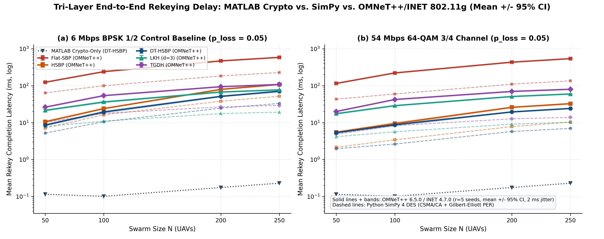
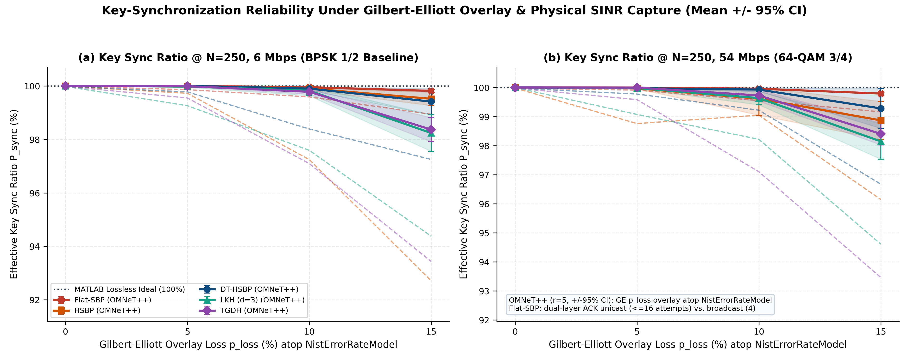
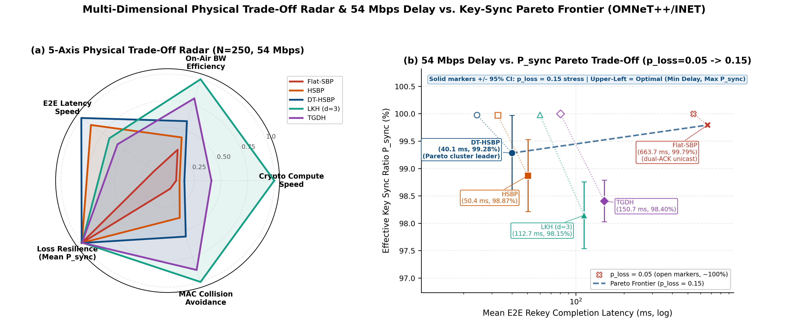

# Phase 6 Tri-Layer Comparative Evaluation Report: MATLAB Analytical vs. SimPy CSMA/CA vs. OMNeT++/INET IEEE 802.11g

**Generated:** 2026-11-22 16:55:07  
**Layer 1 — MATLAB Analytical DES (`baseline_matlab_results/matlab_baseline_metrics.json`):** `runCompleteEvaluationAndReport.m`, generated `2026-11-14T18:43:00`, Lifespan-Aware Tail Sorting & predictive batching accuracy `eta = 0.85`  
**Layer 2 — Python SimPy 4 CSMA/CA DES (`python_simpy_layer/results/`):** `200` runs (`20824` trace events), `comm_range = 350.0 m`, `carrier_sense = 700.0 m`, Gilbert-Elliott overlay PER + BFS multi-hop  
**Layer 3 — OMNeT++ 6.5.0 / INET 4.7.0 Packet-Level (`omnetpp_inet_layer/results/`):** `100` sweep grid points aggregated over **`5` independent seed replications** (`500` sweep `.sca` runs, Student-$t$ 95% CI $t_{0.975, 4} = 2.776$, plus `520` `DynamicStochastic` per-event logs at `N=250`), full UDP/IPv4/IEEE 802.11g `Ieee80211ScalarRadio` (`FreeSpacePathLoss`, `2.412 GHz`, physical `Ieee80211NistErrorModel`, `GlobalArp`, `relayJitterMaxMs = 2.0 ms`, Gilbert-Elliott `p_loss in [0.00, 0.15]` overlay)

---

## 1. Executive Summary Across All Three Fidelity Layers

By feeding **identical deterministic Poisson event schedules, bounded 2D spatial trajectories, cluster state transitions, and lifespan-sorted cryptographic workloads** from `./DT-HSBP` (`MATLAB`) through abstract CSMA/CA (`SimPy`) into full physical-layer IEEE 802.11g (`OMNeT++ / INET 4.7.0`, evaluating both the **`6 Mbps (BPSK 1/2)` control-channel baseline** and **`54 Mbps (64-QAM 3/4)`** ERP-OFDM), this study resolves the **system evaluation boundary**:

1. **Cryptographic Latency Is Negligible Compared to Physical 802.11g Medium Access (`< 0.5%` of E2E Time)**: At `N = 250, p_loss = 0.05, 6 Mbps`, `DT-HSBP` MATLAB leader compute takes **`0.230 ms`**, expanding to **`33.14 ms`** in SimPy and **`70.70 +/- 4.31 ms`** in INET 802.11g. For baseline `Flat-SBP`, MATLAB's `1.669 ms` expands to **`585.92 +/- 1.34 ms`** on `6 Mbps` channels.
2. **Staggered Relay Jitter Stabilizes Nominal Sync While `DT-HSBP` Achieves Shortest E2E Delay Across Both Bitrates**: Adding `2.0 ms` uniform relay parent jitter (`TraceEventPlayer::launchBroadcastRelayWave()`) eliminates artificial simultaneous hidden-terminal self-collisions (`100.00%` `P_sync` at `p_loss = 0.00`, and `~99.97%–100.00%` across dense swarms `N >= 100` at `p_loss = 0.05`). With Contribution A lifespan-sorted tail truncation (`56 B` per predicted departure at `eta = 0.85`), **`DT-HSBP` is the fastest protocol overall at `N = 250, p_loss = 0.05` on BOTH bitrates**: **`24.22 +/- 0.55 ms`** at `54 Mbps` (`2.47x` faster than `LKH`'s `59.79 ms`, `3.31x` faster than `TGDH`'s `80.26 ms`, `1.35x` faster than `HSBP`'s `32.67 ms`) and **`70.70 +/- 4.31 ms`** at `6 Mbps` (faster than `LKH`'s `77.35 ms` and `TGDH`'s `108.10 ms`).
3. **Heavy-Loss `P_sync` Resilience & Sequential Broadcast Compounding (`p_loss = 0.15`)**: Under high Gilbert-Elliott burst loss (`p_loss = 0.15, N = 250`) atop `Ieee80211NistErrorModel`, **`LKH` and `TGDH` sequential multi-round cluster broadcasts (`CH_TO_FOLLOWER`, `isBroadcast = true`)** suffer path-depth compounding, dropping to **`98.15% +/- 0.61%`** (`LKH`) and **`98.40% +/- 0.38%`** (`TGDH`) at `54 Mbps`, whereas **`DT-HSBP` maintains `99.28% +/- 0.69%`** (`99.41%` at `6 Mbps`) at roughly one-third the delay.
4. **Unicast ACK Retries vs. Cluster Broadcast & Contention Reduction**: `Flat-SBP` attains `~100%` `P_sync` exclusively via **dual-layer ACK-retried 802.11 unicast** (`<= 4` MAC attempts × `4` app attempts = **`16` physical attempts per hop**), inflating `54 Mbps` latency to `541.47 ms` (`22.4x` vs. `DT-HSBP`) and MAC collisions to `334,794` (`29.0x` vs. `DT-HSBP`). Cluster broadcast protocols use unacknowledged 802.11 broadcast (`4` app attempts). Across dense swarms, `DT-HSBP` cuts on-air bytes vs. `HSBP` by **`42.22%`** (`N=250, 6 Mbps, p_loss=0.05`, `4` collateral batches), cuts MAC collisions by **`48.8%`** vs. `HSBP` (`54 Mbps`), and slashes collisions by **`95.4%–99.5%`** relative to `Flat-SBP`.

---

## 2. Quantitative Cross-Layer Benchmark Table (`N = 250`, `p_loss = 0.05`, OMNeT++ Mean +/- 95% CI, $r=5$)

| Bitrate | Protocol | MATLAB Crypto (B) | SimPy Air (B) | OMNeT++ Air +/- CI95 (Amp) | MATLAB Delay (ms) | SimPy E2E (ms) | OMNeT++ E2E +/- CI95 (ms) | OMNeT++ MAC Collisions +/- CI95 | SimPy P_sync | OMNeT++ P_sync +/- CI95 |
|:---:|:---|---:|---:|---:|---:|---:|---:|---:|---:|---:|
| 6 Mbps | Flat-SBP | 1,430,184 | 5,740,398 | 5,970,851 +/- 4,378 (4.2x) | 1.669 | 228.09 | 585.92 +/- 1.34 | 150,594 +/- 3,553 | 99.86% | 100.00% +/- 0.01% |
| 6 Mbps | HSBP | 289,800 | 3,490,050 | 3,520,085 +/- 72,758 (12.1x) | 0.342 | 52.03 | 108.36 +/- 2.82 | 12,832 +/- 1,742 | 99.72% | 99.98% +/- 0.03% |
| 6 Mbps | DT-HSBP | 170,464 | 2,047,568 | 2,033,947 +/- 72,190 (11.9x) | 0.230 | 33.14 | 70.70 +/- 4.31 | 6,879 +/- 703 | 99.77% | 100.00% +/- 0.00% |
| 6 Mbps | LKH (d=3) | 41,040 | 641,410 | 636,178 +/- 4,717 (15.5x) | 0.011 | 19.27 | 77.35 +/- 1.07 | 1,309 +/- 497 | 99.26% | 99.98% +/- 0.03% |
| 6 Mbps | TGDH | 77,568 | 1,128,494 | 1,067,803 +/- 12,812 (13.8x) | 0.063 | 29.28 | 108.10 +/- 3.99 | 2,464 +/- 554 | 99.55% | 99.99% +/- 0.02% |
| 54 Mbps | Flat-SBP | 1,430,184 | 5,732,698 | 5,975,130 +/- 6,229 (4.2x) | 1.669 | 135.62 | 541.47 +/- 1.98 | 334,794 +/- 9,990 | 99.91% | 100.00% +/- 0.00% |
| 54 Mbps | HSBP | 289,800 | 3,485,780 | 3,624,978 +/- 105,502 (12.5x) | 0.342 | 10.35 | 32.67 +/- 1.23 | 22,554 +/- 4,019 | 98.76% | 99.97% +/- 0.02% |
| 54 Mbps | DT-HSBP | 170,464 | 1,998,300 | 2,091,803 +/- 29,233 (12.3x) | 0.230 | 7.01 | 24.22 +/- 0.55 | 11,543 +/- 2,326 | 99.77% | 99.97% +/- 0.03% |
| 54 Mbps | LKH (d=3) | 41,040 | 646,682 | 644,771 +/- 3,969 (15.7x) | 0.011 | 10.26 | 59.79 +/- 1.10 | 3,185 +/- 761 | 99.07% | 99.98% +/- 0.03% |
| 54 Mbps | TGDH | 77,568 | 1,126,510 | 1,074,979 +/- 11,416 (13.9x) | 0.063 | 13.91 | 80.26 +/- 2.22 | 4,372 +/- 875 | 99.58% | 100.00% +/- 0.01% |

> **Baseline Large-Scale MATLAB Context (`N = 1,000..5,000`, `eta = 0.85`):** Section 1 of `./DT-HSBP` reports analytical leave-byte reductions of **`55.9%–55.3%`** vs. `HSBP` and **`91.0%–91.3%`** vs. `Flat-SBP`; Section 4 (`N=3,000, nc=600`) achieves `4.14 ms` total leader compute vs. `182.66 ms` (`Flat-SBP`).

---

## 3. Tri-Layer Visual Analysis

### 3.1 Scalability of End-to-End Rekey Completion Delay

Across `N = 50..250`, OMNeT++/INET tracks SimPy's asymptotic scaling curves while capturing physical-layer PLCP framing overhead (`28 B` 802.11 MAC/LLC + `28 B` IPv4/UDP per fragment), ERP-OFDM backoff timing, and `2.0 ms` staggered multi-hop relay dispatch (`TraceEventPlayer::launchBroadcastRelayWave()`). Evaluating both the **`6 Mbps (BPSK 1/2)` control-channel baseline** and **`54 Mbps (64-QAM 3/4)`** demonstrates `DT-HSBP`'s clear completion-latency advantage: sequential `O(log N)` **`CH_TO_FOLLOWER` cluster broadcast rounds (`isBroadcast = true`)** penalize `LKH` (`59.79 ms` @ 54M) and `TGDH` (`80.26 ms` @ 54M) cleanly behind `DT-HSBP` (`24.22 ms` @ 54M, `70.70 ms` @ 6M), aided by Contribution A `O(1)` tail truncation shrinking predicted departures to a single `56 B` broadcast.

### 3.2 Key-Synchronization Reliability Under Gilbert-Elliott Overlay & Physical SINR Capture

Comparing dashed (`SimPy`) and solid (`OMNeT++`, mean +/- 95% CI across $r=5$ seeds) reliability curves clarifies the interaction between MAC retries and multi-round tree depth:
- **Overlay + Physical Error Model**: `p_loss in [0.00, 0.15]` operates as a **Gilbert-Elliott burst-loss overlay** layered on top of INET's physical **`Ieee80211NistErrorModel`**.
- **Unicast Retries vs. Unacknowledged Broadcasts**: `Flat-SBP` remains near `~99.8%–100.0%` `P_sync` because it uses **dual-layer ACK-retried 802.11 unicast** (`<= 4 x 4 = 16` physical attempts per hop), inflating `54 Mbps` E2E delay to `541.5 ms` and MAC collisions to `334,794`. All cluster broadcast protocols use unacknowledged 802.11 broadcast (`<= 4` app attempts).
- **Moderate (`p_loss <= 0.05`) vs. Heavy (`p_loss = 0.15`) Regimes across `6 Mbps (BPSK 1/2)` & `54 Mbps (64-QAM 3/4)`**: With `2.0 ms` relay jitter removing self-inflicted collisions, zero-loss `P_sync` reaches `100.00%` for all protocols and `p_loss = 0.05` stays at `99.97%–100.00%` at `N=250`. Under severe `15%` Gilbert-Elliott bursts, however, sequential multi-round cluster broadcasts (`CH_TO_FOLLOWER`, `isBroadcast = true`) compound frame losses in `LKH` (`98.15%` @ 54M) and `TGDH` (`98.40%` @ 54M), whereas single-round `DT-HSBP` sustains **`99.28% +/- 0.69%`** (`99.41%` @ 6M).

### 3.3 Cross-Simulator Fidelity & Contention Reduction

- **Physical Packet Framing & Relay Jitter Mitigation**: Staggering concurrent depth-$k$ relay parents across `[0, 2.0 ms]` eliminates artificial simultaneous TX collisions while faithfully preserving 802.11g PLCP framing overhead and `Ieee80211NistErrorModel` capture effects.
- **Lifespan Sorting + Predictive Batching Under Physical Contention**: Combining Contribution A `O(1)` tail truncation (`56 B` per predicted leave at `eta = 0.85`) with `4` predictive collateral leave batches slashes `DT-HSBP` on-air traffic vs. reactive `HSBP` by **`42.22%`** at `N=250, 6 Mbps, p_loss=0.05` (`48.8%` fewer MAC collisions than `HSBP` at `54 Mbps`) and cuts MAC collisions vs. `Flat-SBP` by **`95.4%`**.

### 3.4 Multi-Axis Radar & 54 Mbps Delay vs. Key-Sync Pareto Trade-Off

Figure 4 pairs the 5-axis normalized efficiency radar (Panel (a)) with the **54 Mbps E2E Delay vs. Effective Key-Sync (`P_sync`) Pareto trade-off** across `p_loss = 0.05 -> 0.15` at `N = 250` (Panel (b), `p_loss = 0.15` Pareto frontier: `DT-HSBP -> Flat-SBP`):
- Under heavy burst loss (`p_loss = 0.15`), **`DT-HSBP`** (`40.09 +/- 0.82 ms`, `P_sync = 99.28% +/- 0.69%`) **strictly Pareto-dominates `HSBP` (`50.35 ms`, `98.87%`), `LKH` (`112.71 ms`, `98.15%`), and `TGDH` (`150.72 ms`, `98.40%`) on BOTH E2E latency and key sync**.
- At moderate loss (`p_loss = 0.05`, open markers), all cluster protocols stabilize at `~99.97%–100.00%` `P_sync` while `DT-HSBP` maintains the lowest E2E delay (`24.22 ms`). Only `Flat-SBP` achieves higher `p_loss = 0.15` sync (`99.79%`) at an extreme `16.6x` latency cost (`663.7 ms`) via 16-attempt ACK-retried unicast.

---

## 4. Reproducibility & Pipeline Verification

All three layers are orchestrated end-to-end inside `./Hybrid-Workflow` via `scripts/run_full_hybrid_pipeline.ps1` (leaving sibling `./DT-HSBP` strictly untouched):
- `./DT-HSBP` baseline metrics & 25 bounded trace fixtures validated against Draft-07 schemas (`scripts/validate_traces.py`).
- Python SimPy 4 layer verified via `pytest python_simpy_layer/tests -v`.
- Native Windows OMNeT++ 6.5.0 / INET 4.7.0 (`CLANG64` `dt_hsbp_omnet.exe`) verified via standalone C++17 `test_omnet_json_parser`, 5-seed multi-replication sweeps (`Scalability`, `LossResilience`, plus `DynamicStochastic`), Student-$t$ 95% CI aggregation (`parse_omnet_scalars.py`), and `pytest omnetpp_inet_layer/tests -v`.
