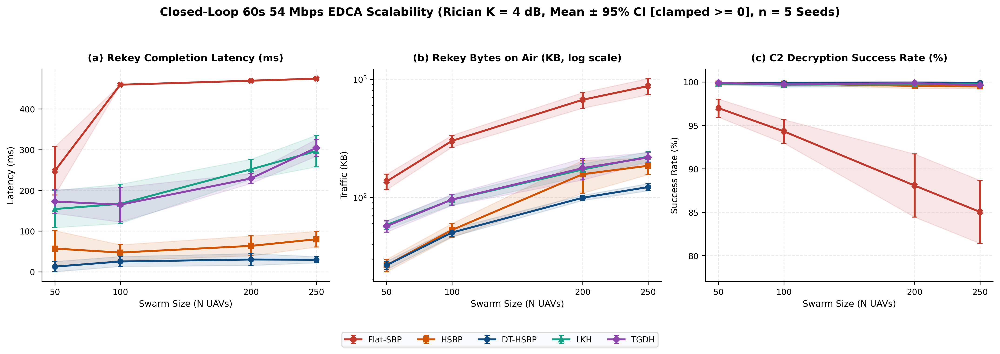
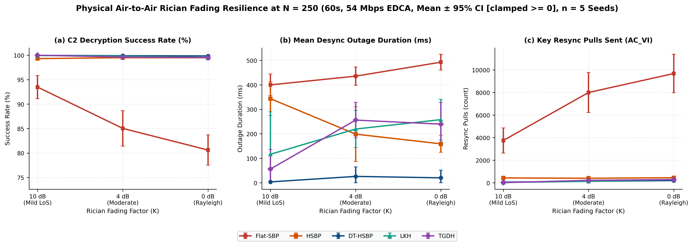
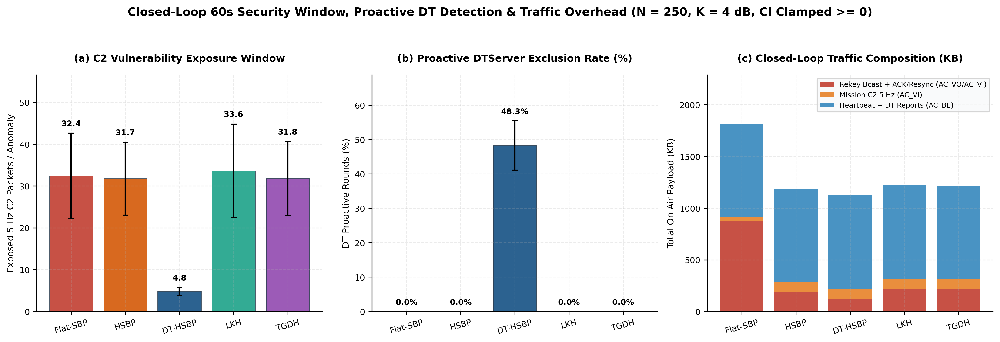
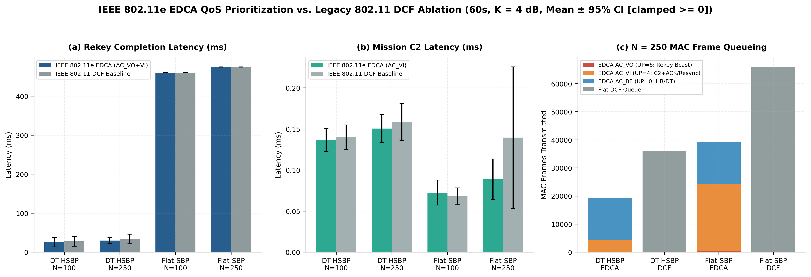

# DT-HSBP Version 2: Closed-Loop 54 Mbps IEEE 802.11e EDCA, Rician Fading & Native Digital-Twin Evaluation

Generated: 2026-11-27 10:27:12
Runs Aggregated: **170** unique OMNeT++ 6.5.0 / INET 4.7.0 simulation runs across **43** parameter cells (`repeat = 5`, two-sided 95% Student-t CI with $t_{0.975,4} = 2.776445$).

## 1. Closed-Loop Protocol & Physical Layer Architecture
- **IEEE 802.11e EDCA (`54 Mbps`, `qosStation = true`)**: Stock INET `Hcf` / `Edcaf` maps CH/SL `REKEY_BCAST_FRAG` & SL failover broadcasts exclusively to **`UP = 6 (AC_VO, cwMin=7, cwMax=31)`**, encrypted `5 Hz` `128 B` `MISSION_C2_BCAST` + follower `REKEY_UNICAST_ACK` & `KEY_RESYNC_PULL` replies to **`UP = 4 (AC_VI, cwMin=15, cwMax=127)`**, and `1 Hz` `64 B` `HEARTBEAT_DT_REPORT` + `5 s` `CH_SUMMARY_TO_SL` to **`UP = 0 (AC_BE)`**.
- **Air-to-Air Physical Channel**: `RicianFading` over `FreeSpacePathLoss` ($\alpha = 2.0$, $f = 2.412\text{ GHz}$, $P_{tx} = 100\text{ mW}$, sensitivity $-71.5\text{ dBm}$) tested across $K \in \{10, 4, 0\}\text{ dB}$ with `Ieee80211NistErrorModel`.
- **Closed-Loop Native Digital Twin**: Each follower's `DTAgent` measures continuous `SwarmMobility` telemetry and transmits in-band `1 Hz` `AC_BE` reports to its CH `DTServer`, which runs a linear constant-velocity Kalman innovation tracker ($D_i(t)$) without oracle knowledge. Only **DT-HSBP** acts proactively on $D_i(t) > \theta_{leave} = 2.5$, using collateral lookahead batching and **Lifespan-Aware Chain Sorting** ($O(1)$ tail truncation).

### Methodological Notes
1. **Flat-SBP Latency Plateau (`~475 ms`)**: Flat-SBP's `~475 ms` completion latency represents the protocol round-timeout ceiling (`ackDeadlineSec = 0.45 s` + crypto delay) triggered when fragmented swarm-wide broadcasts fail to collect an `80%` follower ACK quorum under multi-hop contention.
2. **Consistent `DT Hit` and `Exposure` Across Fading Regimes**: Identical `DT Hit` (`%`) and `Exposure` (`packets`) values across moderate ($K = 4\text{ dB}$) and severe Rayleigh ($K = 0\text{ dB}$) fading arise from paired exogenous disturbance schedules (`seed-set = 0..4`) and resilient `1 Hz` `64 B` heartbeats producing the same Kalman threshold crossings ($D_i(t) > 2.5$).
3. **Separated In-Band EDCA Traffic Mapping**: Lower-bound 95% Student-t CI error bars are clamped to the physical non-negative floor (`max(0, mean - CI95)`); `AC_VO` (`UP = 6`) preempts exclusively for Rekey Broadcasts, while `AC_VI` (`UP = 4`) carries Mission C2 + Rekey ACKs/Resync and `AC_BE` (`UP = 0`) carries `1 Hz` Heartbeat+DT telemetry.

## 2. Headline Results at N = 250 UAVs (54 Mbps EDCA)
- At moderate fading ($K = 4\text{ dB}$), **DT-HSBP** achieves **48.3%** proactive exclusion, reducing C2 security exposure window to **4.77 packets** (**84.9%** reduction vs. HSBP, **85.3%** reduction vs. Flat-SBP).
- On-air rekey traffic at $N = 250$ drops to **122.0 KB** (**34.0%** vs. HSBP, **86.1%** vs. Flat-SBP), sustaining **99.89%** C2 decryption success rate vs. **85.04%** under Flat-SBP.
- Under severe Rayleigh multipath fading ($K = 0\text{ dB}$), DT-HSBP maintains **99.85%** C2 decryption reliability (vs. **80.61%** for Flat-SBP) and **20.1 ms** mean key-desync outage.
- **MAC Queue Overflow Drops**: `0` across all 170 simulation runs.

### Table 1: N = 250, 54 Mbps EDCA, Moderate Fading (Rician K = 4 dB, Mean ± 95% CI)
| Protocol | DT Hit | Rekey Bytes (KB) | Rekey Latency (ms) | C2 Decrypt Rate | C2 Exposure (pkts) | Desync Outage (ms) | Resync Pulls |
|---|---:|---:|---:|---:|---:|---:|---:|
| Flat-SBP | 0.0% | 875.1 ± 137.9 KB | 474.5 ± 0.3 ms | 85.04% ± 3.63% | 32.38 ± 10.21 | 435.5 ± 37.6 ms | 7998 |
| HSBP | 0.0% | 185.0 ± 29.5 KB | 79.8 ± 19.2 ms | 99.49% ± 0.26% | 31.71 ± 8.69 | 198.6 ± 111.4 ms | 399 |
| DT-HSBP | 48.3% | 122.0 ± 8.5 KB | 29.4 ± 7.6 ms | 99.89% ± 0.06% | 4.77 ± 0.94 | 26.0 ± 38.9 ms | 132 |
| LKH | 0.0% | 220.9 ± 22.2 KB | 296.6 ± 38.8 ms | 99.79% ± 0.19% | 33.58 ± 11.18 | 219.5 ± 75.4 ms | 127 |
| TGDH | 0.0% | 217.4 ± 21.7 KB | 304.6 ± 20.8 ms | 99.62% ± 0.31% | 31.77 ± 8.82 | 256.0 ± 72.4 ms | 216 |

### Table 2: N = 250, 54 Mbps EDCA, Severe Rayleigh Fading (Rician K = 0 dB, Mean ± 95% CI)
| Protocol | DT Hit | Rekey Bytes (KB) | Rekey Latency (ms) | C2 Decrypt Rate | C2 Exposure (pkts) | Desync Outage (ms) | Resync Pulls |
|---|---:|---:|---:|---:|---:|---:|---:|
| Flat-SBP | 0.0% | 920.6 ± 129.1 KB | 474.5 ± 0.3 ms | 80.61% ± 3.11% | 33.64 ± 8.74 | 492.5 ± 32.3 ms | 9680 |
| HSBP | 0.0% | 253.2 ± 77.7 KB | 85.2 ± 24.2 ms | 99.48% ± 0.19% | 31.71 ± 8.69 | 159.0 ± 34.8 ms | 448 |
| DT-HSBP | 48.3% | 124.7 ± 9.9 KB | 27.4 ± 5.7 ms | 99.85% ± 0.06% | 4.77 ± 0.94 | 20.1 ± 31.0 ms | 195 |
| LKH | 0.0% | 218.3 ± 52.2 KB | 359.1 ± 44.8 ms | 99.52% ± 0.31% | 35.36 ± 10.44 | 257.8 ± 83.2 ms | 286 |
| TGDH | 0.0% | 220.9 ± 59.9 KB | 384.4 ± 30.8 ms | 99.52% ± 0.48% | 35.26 ± 9.02 | 239.4 ± 88.5 ms | 287 |

## 3. Visualizations

