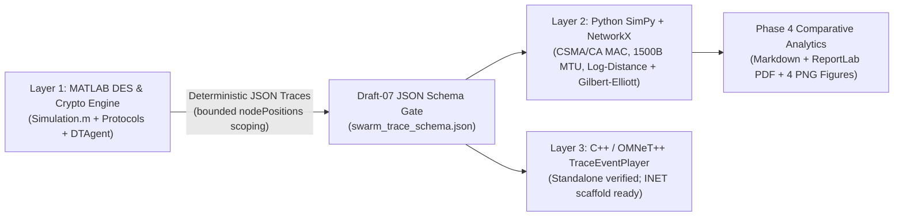

# DT-HSBP Hybrid Cryptographic-Network Evaluation Architecture

## Overview

The `./Hybrid-Workflow` repository bridges DT-HSBP's analytical MATLAB swarm simulator (**Layer 1**) with realistic packet-level wireless network emulation in Python SimPy + NetworkX (**Layer 2**) and a Windows C++/OMNeT++ INET trace integration scaffold (**Layer 3**).



## Bounded `nodePositions` Scoping & Carry-Forward Reconstruction

At large swarm sizes (`N = 1000`), serializing full-swarm 2D positions per event would cause `O(E * N)` JSON bloat. Instead, Layer 1 exports all `N` nodes in `initialNodes`, and each event emits only the **Swarm Leader (SL)**, the target cluster's **Cluster Head (CH)**, and the post-event **active followers of `ev.clusterId`** inside `ev.nodePositions`.

Layer 2 (`TopologyManager`) and Layer 3 (`TraceEventPlayer`) reconstruct exact global 2D mobility by carrying forward prior coordinates for uninvolved clusters:

```mermaid
sequenceDiagram
    participant M as MATLAB TraceExporter
    participant L as Layer 2/3 Topology Cache
    M->>L: initialNodes (all N active UAVs)
    loop For each event ev on cluster c
        M->>L: ev.nodePositions (SL + cluster c active members <= nc+1)
        Note over L: Update SL and cluster c positions;<br/>carry forward clusters k != c unchanged
        L->>L: Reconcile CH/SL role if head departed
    end
```

## Protocol & Channel Model Grounding

- **Cryptographic Payload Scaling**: `FlatSBP`, `HSBP`, `DTHSBP` = `56 B/msg`; `LKH` = `48 B/msg` (`32 B key + 16 B header`); `TGDH` = `128 B/token`; `dtDisturbance` = `controlSize * affectedCount` (`16 B`).
- **MTU Fragmentation**: Payloads exceeding `mtu = 1500 B` (such as large-cluster `CH_TO_FOLLOWER` DH broadcasts at `nc = 200` -> `11,200 B` = `8` fragments) undergo link-layer fragmentation; losing any unrecovered fragment drops key synchronization.
- **Wireless Medium**: Distance-dependent PER (short range `<= 50 m`: `PER <= p_loss + 0.02`; out-of-range `> 350 m`: cliff `PER >= 0.85`), log-distance path loss + log-normal shadowing, Gilbert-Elliott bursty fading, `d / 3e8` propagation delay, and IEEE 802.11p/15.4 spatial CSMA/CA (`700 m` carrier sense, exponential backoff `CW_min=15 .. CW_max=1023`, `max_retries=3`).
